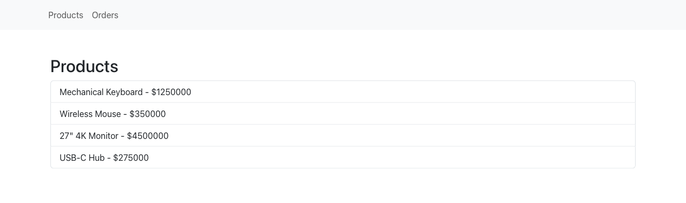
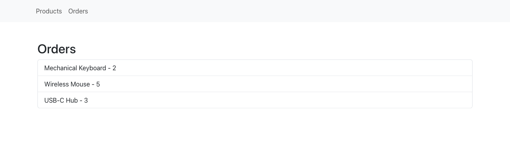
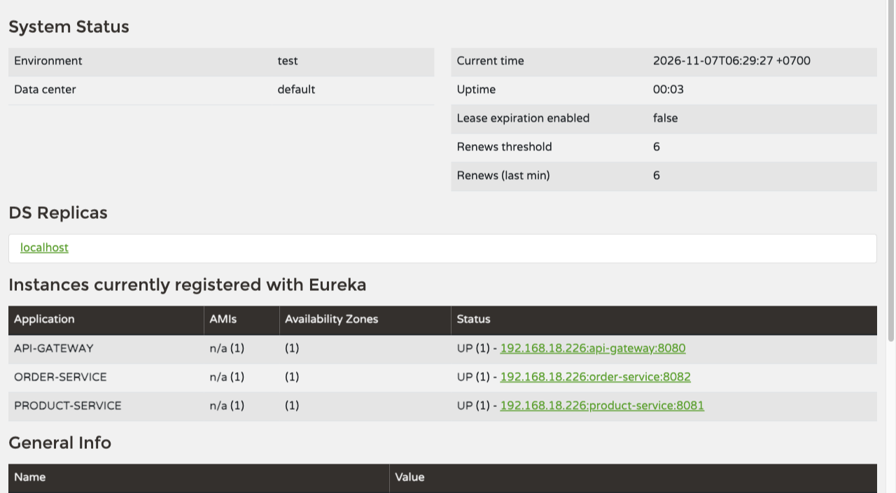

# spring-boot-react-sample

[](https://github.com/hendisantika/spring-boot-react-sample/actions/workflows/maven.yml)


[](LICENSE)

Spring Boot + React sample with a microservice architecture: service discovery (Eureka), an API gateway
(Spring Cloud Gateway), two business services (product & order) and a React frontend.

## Screenshots

### React frontend — Products



### React frontend — Orders



### Eureka dashboard

All services registered with the service registry (`order-service` running on port `8082`):



## Tech Stack

| Layer              | Technology                                                       |
|--------------------|------------------------------------------------------------------|
| Language / Runtime | Java 25 (Temurin / any JDK 25 distribution)                      |
| Framework          | Spring Boot 4.1.2, Spring Cloud 2025.1.4                         |
| Service discovery  | Spring Cloud Netflix Eureka                                      |
| API gateway        | Spring Cloud Gateway (`spring-cloud-starter-gateway-server-webflux`) |
| Persistence        | Spring Data JPA + H2 (in-memory)                                 |
| Boilerplate        | Lombok                                                           |
| Frontend           | React 18, React Router, Axios, Bootstrap 5                       |
| Build              | Maven (one `pom.xml` per service)                                |
| CI / Dependencies  | GitHub Actions, Dependabot                                       |

## Architecture

```
                    ┌──────────────────────┐
                    │    react-frontend    │  :3000
                    └──────────┬───────────┘
                               │ HTTP
                    ┌──────────▼───────────┐
                    │     api-gateway      │  :8080
                    │  /products/** → lb://product-service
                    │  /orders/**   → lb://order-service
                    └──────────┬───────────┘
                 ┌─────────────┴─────────────┐
      ┌──────────▼──────────┐     ┌──────────▼──────────┐
      │   product-service   │     │    order-service    │
      │  :8081  (H2 memory) │     │  :8080* (H2 memory) │
      └──────────┬──────────┘     └──────────┬──────────┘
                 └─────────────┬─────────────┘
                    ┌──────────▼───────────┐
                    │    eureka-server     │  :8761
                    └──────────────────────┘
```

## Modules

| Module            | Port    | Description                                    |
|-------------------|---------|------------------------------------------------|
| `eureka-server`   | `8761`  | Eureka service registry / dashboard            |
| `api-gateway`     | `8080`  | Routes `/products/**` & `/orders/**` via Eureka, CORS enabled |
| `product-service` | `8081`  | Product CRUD (`id`, `name`, `price`)           |
| `order-service`   | `8080`* | Order CRUD (`id`, `product`, `quantity`)       |
| `react-frontend`  | `3000`  | React UI for products and orders               |

> \* `order-service` and `api-gateway` both default to port `8080`. To run them together, override one of them,
> e.g. `mvn spring-boot:run -Dspring-boot.run.arguments=--server.port=8082` in `order-service`.

## REST Endpoints

| Method | Path              | Description          |
|--------|-------------------|----------------------|
| GET    | `/products`       | List all products    |
| POST   | `/products`       | Create a product     |
| GET    | `/products/{id}`  | Get product by id    |
| GET    | `/orders`         | List all orders      |
| POST   | `/orders`         | Create an order      |
| GET    | `/orders/{id}`    | Get order by id      |

Example:

```bash
curl -X POST http://localhost:8081/products \
  -H 'Content-Type: application/json' \
  -d '{"name":"Keyboard","price":250000}'

curl http://localhost:8081/products
```

The H2 console is available at `/h2-console` on `product-service` and `order-service`.

## Prerequisites

- JDK 25 (e.g. `sdk install java 25-tem`)
- Maven 3.9+
- Node.js 18+ and npm (or pnpm) for the frontend

## Build

Each service is an independent Maven project:

```bash
mvn -B package --file ./eureka-server/pom.xml
mvn -B package --file ./api-gateway/pom.xml
mvn -B package --file ./product-service/pom.xml
mvn -B package --file ./order-service/pom.xml
```

## Run

Start the services in this order (each in its own terminal):

```bash
cd eureka-server   && mvn spring-boot:run
cd product-service && mvn spring-boot:run
cd order-service   && mvn spring-boot:run -Dspring-boot.run.arguments=--server.port=8082
cd api-gateway     && mvn spring-boot:run
```

Then the frontend:

```bash
cd react-frontend
npm install
npm start
```

- Eureka dashboard: http://localhost:8761
- Gateway: http://localhost:8080/products, http://localhost:8080/orders
- Frontend: http://localhost:3000

> The frontend API base URLs are configured in `react-frontend/src/api/ProductService.js` and
> `react-frontend/src/api/OrderService.js`.

## Notes on JDK 25

Since JDK 23, `javac` no longer runs annotation processors found on the classpath implicitly. `order-service` and
`product-service` therefore register Lombok and `spring-boot-configuration-processor` explicitly in the
`maven-compiler-plugin` `annotationProcessorPaths`.

## CI

[`.github/workflows/maven.yml`](.github/workflows/maven.yml) builds and tests every service with Temurin JDK 25 on
each push / pull request to `main`, then submits the Maven dependency graph for Dependabot alerts.

## Dependabot

[`.github/dependabot.yml`](.github/dependabot.yml) keeps dependencies up to date:

| Ecosystem      | Directory                               | Schedule (Asia/Jakarta) | Groups                                                   |
|----------------|-----------------------------------------|-------------------------|----------------------------------------------------------|
| Maven          | all four service directories            | daily 05:00             | `spring-boot`, `spring-cloud`, `test`, `maven-minor-patch` |
| npm            | `/react-frontend`                       | weekly, Monday 05:00    | `react`, `testing-library`, `npm-minor-patch`            |
| GitHub Actions | `/`                                     | weekly, Monday 05:00    | `github-actions`                                         |

PRs are labelled (`dependencies` + ecosystem), assigned to the maintainer and use `chore(deps)` / `ci(deps)` commit prefixes.

## Author

**Hendi Santika** — [s.id/hendisantika](https://s.id/hendisantika) · Telegram [@hendisantika34](https://t.me/hendisantika34)

## License

[MIT](LICENSE)
